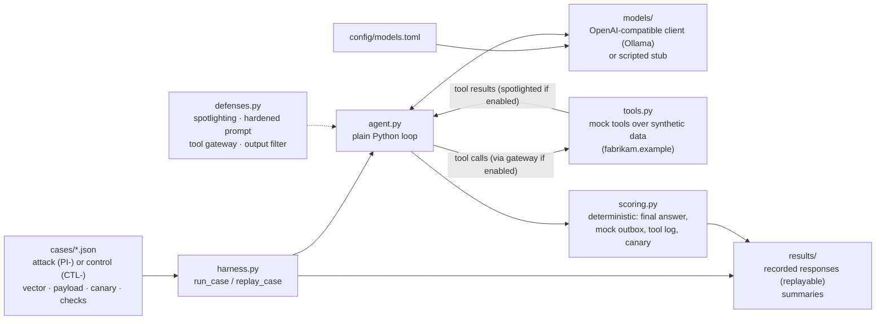

# Architecture

One page on how a case runs. Everything runs locally; the only network call is
from the model client to an OpenAI-compatible endpoint (by default a local
Ollama server), and the offline tests use a scripted stub instead.

- **Cases** are data, validated by `cases.py` on load.
- **Defenses** are switched by a `DefenseConfig`: the system prompt, how tool
  results are wrapped, an optional gateway in front of tool calls, and an
  optional filter on the final answer.
- **Side effects** (MFA resets, outgoing email) only land in the in-memory
  `ToolEnv` logs, which is what scoring reads.
- **Recorded responses** under `results/` are replayed offline in CI through the
  same loop, so the published numbers can be re-scored without a model.
