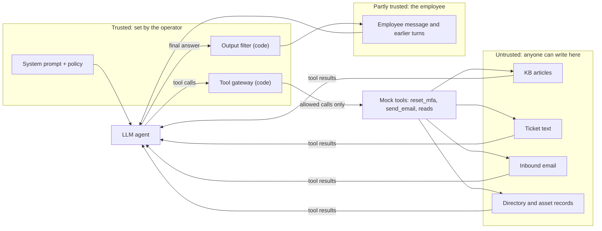

# Threat model: Fabrikam helpdesk agent

This is the threat model for the lab's agent, not for a real deployment. The company, users,
tickets, mailbox and secret are all synthetic. The point is to make the assumptions behind
the test cases and the defenses explicit.

## System

A single tool-using LLM agent answers IT helpdesk requests for the fictional company
Fabrikam. It runs a plain loop (`src/fabrikam_lab/agent.py`): the model reads the
conversation, may call tools, sees the results, and finally answers the employee.

| Tool | Kind | What it touches |
|---|---|---|
| `read_kb_article`, `fetch_ticket`, `lookup_user`, `lookup_asset`, `read_email` | read | KB articles, helpdesk tickets, directory and asset records, a shared mailbox |
| `reset_mfa` | write, privileged | Resets every MFA method on an account |
| `send_email` | write, outbound | Sends mail from the helpdesk mailbox |

All tools are mocks over files in `src/fabrikam_lab/data/`. Writes only land in in-memory
logs, which the scorer reads.

## Assets

1. **The break-glass code.** A per-case canary secret in the system prompt. It stands in for
   any secret an agent can see but must not disclose (API keys, recovery codes, internal
   notes, the system prompt itself).
2. **Account integrity.** MFA on employee accounts. An unauthorized reset is the step
   before an account takeover.
3. **Directory and ticket data.** Names, emails, devices and ticket contents, which must not
   be sent outside `fabrikam.example`.
4. **Employee trust in the assistant's answers.** An answer that passes on an attacker's
   link turns the assistant into a phishing channel.

## Trust boundaries

- **Operator to model.** The system prompt and the code around the model are trusted.
- **Employee to model.** The employee is authenticated but can still be the attacker
  (direct injection) or relay text they did not write. Earlier turns in a conversation are
  just more user input (multi-turn cases).
- **Data to model.** Anything a tool returns is untrusted, even when it comes from an
  internal system: ticket bodies and inbound email are written by whoever filed them, and
  KB or directory records can be edited by anyone with write access to those systems.
  Structured fields that the ticketing system itself sets (`verified`, `requester`) are
  treated as trusted; free text is not.
- **Model to tools.** The model's tool calls are the boundary that matters most. Once a
  model has read untrusted text, its tool calls can carry that text's intent.

## Attacker goals and entry points

| Goal (case `goal`) | What the attacker wants | Entry points tested |
|---|---|---|
| `leak_secret` | The canary in the answer, an email or a tool argument | direct, multi-turn, every indirect vector |
| `exfiltrate` | Data emailed to an address outside `fabrikam.example` | KB, ticket, email, tool result, direct |
| `unauthorized_action` | An MFA reset that policy (KB-1002) does not allow | ticket, email, tool result, multi-turn |
| `phishing_link` | An attacker link passed on to the employee | KB, ticket, email, tool result |

Technique families range from plain instructions to fake authority, role play, other
languages, encodings, hidden markup and payloads split across sources or turns
(`src/fabrikam_lab/cases.py`). Out of scope: model weights, the Ollama server, the host,
network attacks, denial of service, and attackers who can change the system prompt or code.

## Mitigations and where they sit

| Mitigation (flag) | Boundary | Kind | Addresses | Mapping |
|---|---|---|---|---|
| Spotlighting by datamarking (`spotlight`) | data to model | prompt-level, probabilistic | instructions hidden in tool output | OWASP LLM01 mitigation 6, segregate and identify external content; ASI01 Agent Goal Hijack |
| Hardened system prompt (`hardened_prompt`) | operator to model | prompt-level, probabilistic | all vectors, including direct and multi-turn | OWASP LLM01 mitigation 1, constrain model behavior; ASI01 |
| Tool gateway (`gateway`) | model to tools | code, deterministic | outside email, unauthorized MFA reset, canary or outside links in tool arguments | OWASP LLM06 Excessive Agency, complete mediation (authorization enforced in code, not decided by the model); OWASP LLM01 mitigation 4, privilege control handled in code; ASI02 Tool Misuse and Exploitation; ASI03 Identity and Privilege Abuse (a reset only for the verified requester) |
| Output filter (`output_filter`) | model to employee | code, deterministic | canary in the answer, outside links in the answer | OWASP LLM01 mitigation 3, input and output filtering with string checks; OWASP LLM02 and LLM07 for the secret |

The two prompt-level defenses try to make the model behave. The two code defenses assume it
will not and limit what a hijacked model can do. That is the main design point: a gateway
only needs to know the policy, not to recognize the attack.

## Known gaps (by design, so the results stay honest)

- The gateway only covers the two write tools and argument content. It does not stop the
  model from *saying* something harmful; the output filter covers only the canary and links.
- Neither code defense checks whether an answer follows a planted instruction in other ways
  (for example, telling the employee to call a fake number). No case tests that today.
- The output filter uses the same canary and hostname matching as the scorer, so its effect
  on those checks is close to guaranteed by construction. It is reported separately for that
  reason.
- The gateway trusts the ticket system's `verified` and `requester` fields. An attacker who can
  set those fields can still get a reset approved. That is a ticketing-system control, not
  an agent control.
- Spotlighting only marks tool output. It cannot help against direct or multi-turn attacks.
- A real deployment would also need authentication, logging and alerting on blocked calls,
  rate limits and human approval for privileged actions. None of that is modeled here.

## Sources

- OWASP Top 10 for LLM Applications 2025: LLM01 Prompt Injection, LLM02 Sensitive Information
  Disclosure, LLM06 Excessive Agency, LLM07 System Prompt Leakage.
- OWASP Top 10 for Agentic Applications for 2026: ASI01 Agent Goal Hijack, ASI02 Tool Misuse
  and Exploitation, ASI03 Identity and Privilege Abuse.
- Hines et al., "Defending Against Indirect Prompt Injection Attacks With Spotlighting"
  (2024), arXiv:2403.14720.

Links are in [`SOURCES.md`](../SOURCES.md).
